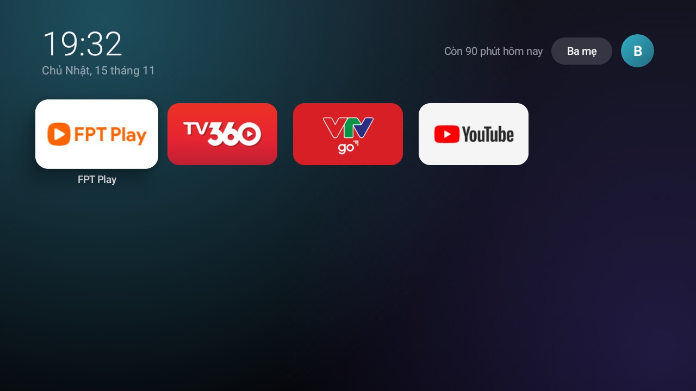
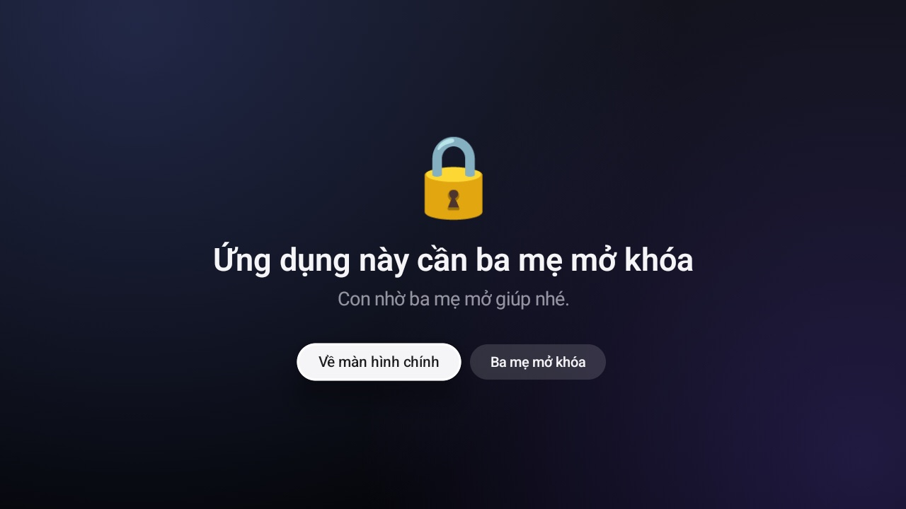
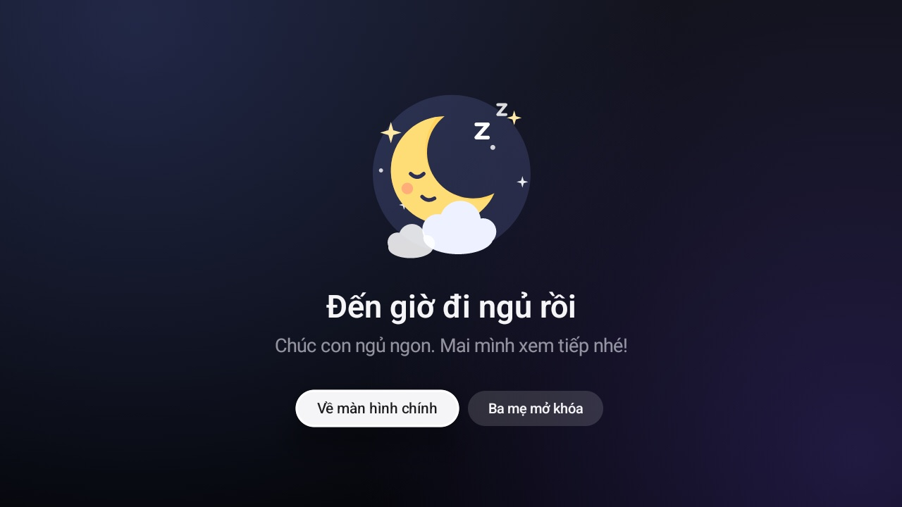
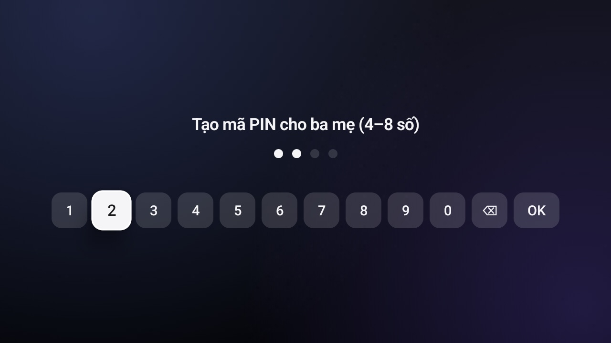
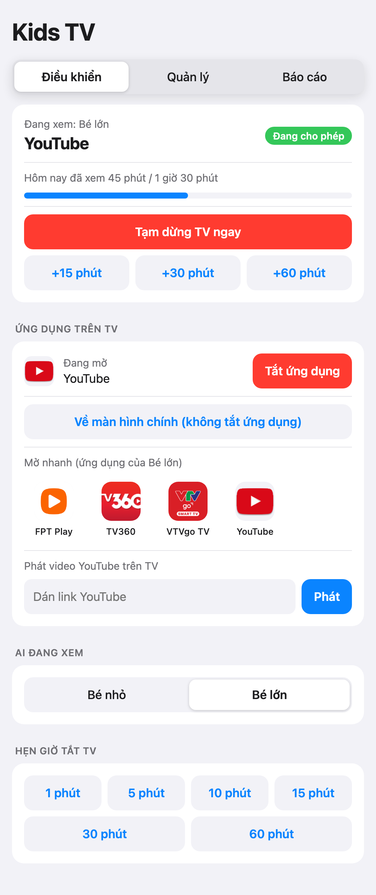
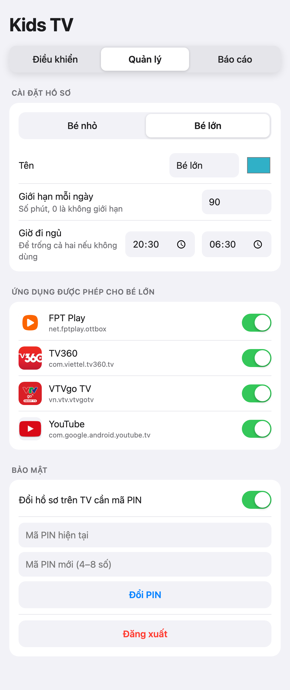
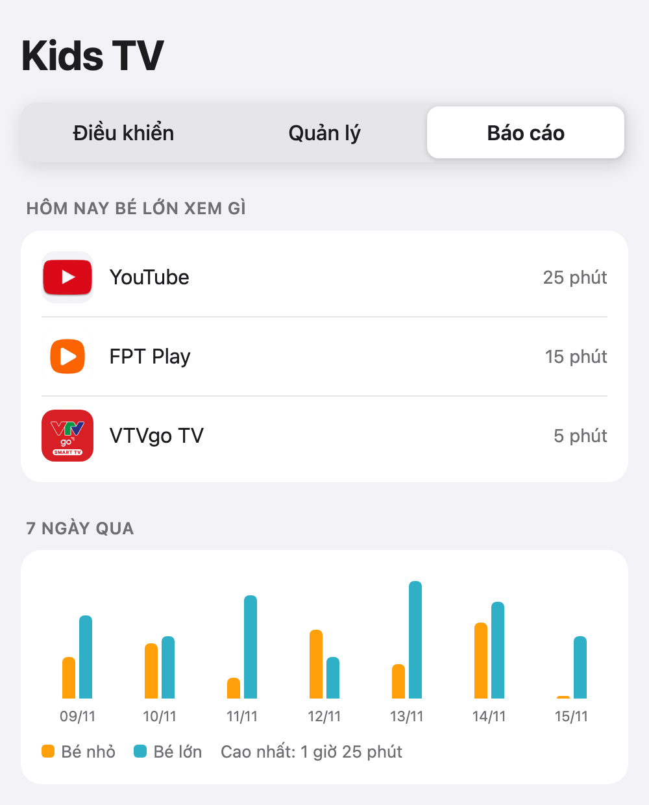

# Kids TV Launcher

Biến Android TV box trong phòng các bé thành một chiếc TV an toàn: bé chỉ thấy những
ứng dụng ba mẹ cho phép, xem đủ giờ thì TV tự khóa, và ba mẹ điều khiển mọi thứ từ
điện thoại.

Không cần root, không cần tài khoản hay dịch vụ bên ngoài. Mọi thứ chạy ngay trên box
và chỉ trong mạng Wi‑Fi nhà bạn.

## Ảnh màn hình

**Trên TV** (chụp từ box thật)

| Màn hình chính của một hồ sơ | Ứng dụng ngoài danh sách bị khóa |
|---|---|
|  |  |

| Đến giờ đi ngủ | Nhập mã PIN của ba mẹ |
|---|---|
|  |  |

**Trên điện thoại** (trang quản lý dựng với dữ liệu mẫu)

| Điều khiển | Quản lý | Báo cáo |
|---|---|---|
|  |  |  |

## Ứng dụng làm được gì

**Cho các bé**

- Màn hình chính đơn giản, chỉ có các ứng dụng của bé, không quảng cáo và không gợi ý nội dung.
- Mỗi bé một hồ sơ riêng với danh sách ứng dụng, số phút được xem mỗi ngày và giờ đi ngủ riêng.
- Khi hết giờ hoặc đến giờ ngủ, TV hiện một lời nhắn nhẹ nhàng thay vì tắt đột ngột.

**Cho ba mẹ**

- Mọi ứng dụng ngoài danh sách, kể cả Cài đặt và cửa hàng ứng dụng, đều cần mã PIN.
- Điều khiển từ điện thoại: tạm dừng TV, cho thêm giờ, tắt ứng dụng đang mở, mở nhanh một
  ứng dụng, phát một video YouTube, hẹn giờ tắt và bật lại TV.
- Xem hôm nay bé đã xem gì, bao lâu, và biểu đồ 7 ngày gần nhất.

## Cần chuẩn bị

- Một Android TV box chạy Android 9 trở lên.
- Một máy tính (Mac, Windows hoặc Linux) để cài ứng dụng lên box lần đầu.
- Điện thoại và box dùng chung mạng Wi‑Fi nhà.
- File cài đặt `kids-tv-launcher.apk`, tải từ mục
  [Releases](https://github.com/trungtnm/kids-tv-launcher/releases/latest) của repo này.
  Bạn cũng có thể tự dựng từ mã nguồn theo [DEVELOPMENT.md](DEVELOPMENT.md).

## Cài đặt

Việc cài đặt chỉ làm một lần và mất khoảng 15 phút. Bạn sẽ gõ vài lệnh trên máy tính;
không cần biết lập trình.

**1. Bật chế độ gỡ lỗi trên box**

Trên TV, vào Cài đặt → Tùy chọn thiết bị → Giới thiệu, bấm vào dòng "Bản dựng" 7 lần.
Quay lại, mở "Tùy chọn cho nhà phát triển" và bật "Gỡ lỗi USB" (trên một số box là
"Gỡ lỗi qua mạng"). Ghi lại địa chỉ IP của box trong Cài đặt → Mạng, ví dụ `192.168.1.20`.

**2. Cài công cụ `adb` trên máy tính**

- Mac: `brew install android-platform-tools`
- Windows và Linux: tải "SDK Platform-Tools" từ trang Android Developers và giải nén.

**3. Cài ứng dụng lên box**

Thay `<IP>` bằng địa chỉ của box. Ở lệnh đầu tiên, TV sẽ hỏi có cho phép máy tính này
không; hãy chọn "Luôn cho phép" rồi bấm OK.

```sh
adb connect <IP>:5555
adb install -r kids-tv-launcher.apk
adb shell settings put secure enabled_accessibility_services com.kidstv.launcher/com.kidstv.launcher.GuardService
adb shell settings put secure accessibility_enabled 1
adb shell pm disable-user --user 0 com.google.android.tvlauncher
adb shell input keyevent KEYCODE_HOME
```

Lệnh thứ năm tắt màn hình chính gốc của Google để nút Home luôn về màn hình mới. Bạn bật
lại được bất cứ lúc nào, xem mục [Gỡ bỏ](#gỡ-bỏ).

**4. Tạo mã PIN**

TV sẽ hiện màn hình "Tạo mã PIN cho ba mẹ". Dùng remote nhập 4 đến 8 chữ số, bấm OK,
rồi nhập lại lần nữa. Đừng để các bé thấy mã này.

**5. Mở trang quản lý trên điện thoại**

Trên TV, chọn nút "Ba mẹ" và nhập mã PIN: góc trên màn hình hiện một mã QR. Dùng camera
điện thoại quét mã đó (hoặc tự gõ `http://<IP>:8765` vào trình duyệt), rồi nhập mã PIN.
Trên iPhone, bấm Chia sẻ → "Thêm vào MH chính" để có biểu tượng như một ứng dụng.

**6. Thiết lập cho từng bé**

Vào tab **Quản lý**, chọn hồ sơ, rồi đặt tên, số phút mỗi ngày, giờ đi ngủ và bật các ứng
dụng bé được dùng. Bấm "Lưu thay đổi".

### Nên làm thêm

- **Chặn trang người lớn** trong mọi ứng dụng bằng bộ lọc gia đình của Cloudflare:

  ```sh
  adb shell settings put global private_dns_specifier family.cloudflare-dns.com
  adb shell settings put global private_dns_mode hostname
  ```

- **Gỡ trình duyệt, trình tải file và các kho ứng dụng lạ** khỏi box, vì đó là đường dẫn
  đến nội dung không phù hợp.
- **Dùng hồ sơ trẻ em trong YouTube** nếu bé còn nhỏ. Ứng dụng này quản lý việc bé được mở
  ứng dụng nào và trong bao lâu, chứ không lọc nội dung bên trong từng ứng dụng.

## Dùng hằng ngày

### Trên TV

- **Đổi hồ sơ:** chọn hình tròn ở góc trên bên phải, rồi chọn bé đang xem.
- **Chế độ ba mẹ:** chọn nút "Ba mẹ" và nhập mã PIN. Mọi ứng dụng mở khóa trong 15 phút và
  không tính vào giờ xem của bé. Chọn "Khóa lại" khi xong.
- **Khi TV bị khóa:** chọn "Ba mẹ mở khóa", nhập mã PIN, rồi chọn cho thêm 15, 30 hoặc
  60 phút.

### Trên điện thoại

| Tab | Dùng để |
|---|---|
| **Điều khiển** | Tạm dừng TV, cho thêm giờ, tắt hoặc mở ứng dụng, phát link YouTube, đổi bé đang xem, hẹn giờ tắt, bật lại TV |
| **Quản lý** | Sửa hồ sơ của từng bé, chọn ứng dụng được phép, đổi mã PIN |
| **Báo cáo** | Xem hôm nay bé xem gì và thời gian xem trong 7 ngày |

Một vài mẹo:

- **Phát video YouTube:** trong ứng dụng YouTube trên điện thoại, bấm Chia sẻ → Sao chép
  đường liên kết, rồi dán vào ô "Dán link YouTube" và bấm "Phát".
- **Hẹn giờ tắt:** hết giờ, TV đóng ứng dụng đang xem và tắt màn hình. Bật lại bằng remote
  hoặc nút "Bật TV" trên điện thoại.
- **Khóa việc đổi hồ sơ:** bật "Đổi hồ sơ trên TV cần mã PIN" trong tab Quản lý để bé nhỏ
  không tự chuyển sang hồ sơ của anh chị.

## Câu hỏi thường gặp

**Quên mã PIN thì làm sao?**
Gỡ ứng dụng rồi cài lại (`adb uninstall com.kidstv.launcher`, sau đó làm lại bước 3). Mã
PIN và toàn bộ hồ sơ sẽ bị xóa, bạn thiết lập lại từ đầu.

**Điện thoại không mở được trang quản lý.**
Kiểm tra điện thoại đang dùng đúng Wi‑Fi nhà, không phải 4G. Nếu vẫn không được, địa chỉ
IP của box có thể đã đổi; xem lại trong Cài đặt → Mạng trên TV. Bạn nên đặt IP cố định
cho box trong bộ phát Wi‑Fi.

**Ra ngoài có điều khiển được không?**
Không. Trang quản lý chỉ hoạt động khi điện thoại ở cùng mạng Wi‑Fi với box.

**Bấm "Bật TV" mà màn hình TV không sáng.**
Nút này đánh thức box. Chiếc TV có tự bật theo hay không tùy vào tính năng HDMI‑CEC của
TV; nếu không, hãy bật TV bằng remote của TV.

**Bé có vượt qua được không?**
Với trẻ nhỏ thì đây là rào chắn chắc chắn. Một đứa trẻ lớn rành công nghệ vẫn có thể khôi
phục cài đặt gốc của box bằng nút cứng, và việc đó xóa toàn bộ thiết lập.

**Cập nhật ứng dụng có mất dữ liệu không?**
Không. Cài bản mới bằng `adb install -r kids-tv-launcher.apk` giữ nguyên mã PIN, hồ sơ và
thời gian đã xem.

## Gỡ bỏ

```sh
adb shell pm enable com.google.android.tvlauncher
adb uninstall com.kidstv.launcher
adb shell settings put global private_dns_mode off
```

Box trở lại màn hình chính gốc của Google.

## Lưu ý về an toàn

- Trang quản lý không mã hóa kết nối, nên chỉ dùng trong mạng nhà. Đừng mở cổng 8765 ra
  Internet.
- Sau khi cài xong, bạn có thể tắt "Gỡ lỗi USB" trên box. Khi cần cập nhật ứng dụng thì
  bật lại.

## Dành cho người phát triển

Hướng dẫn dựng từ mã nguồn, kiến trúc và API nằm trong [DEVELOPMENT.md](DEVELOPMENT.md).
