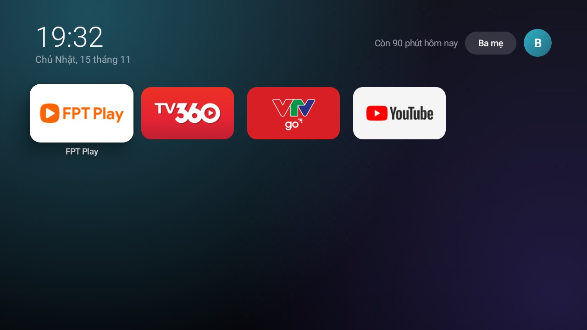
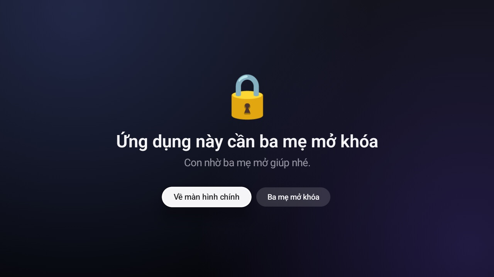
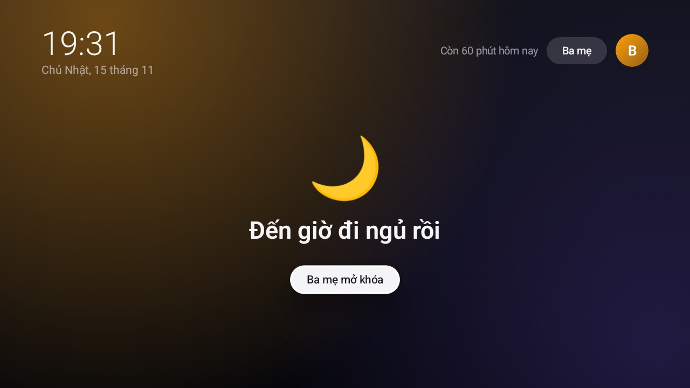
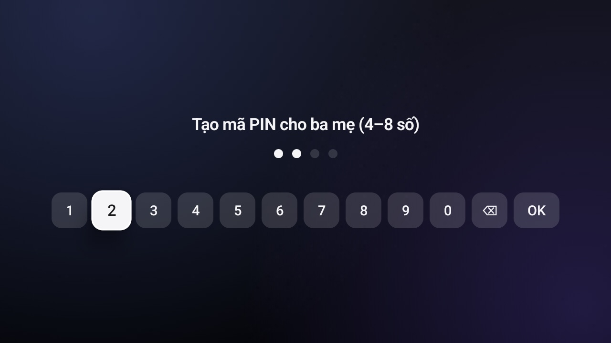
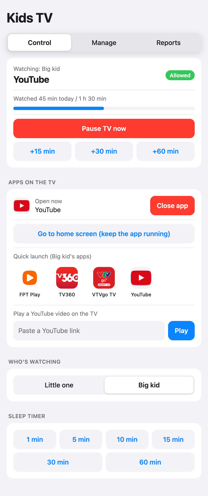
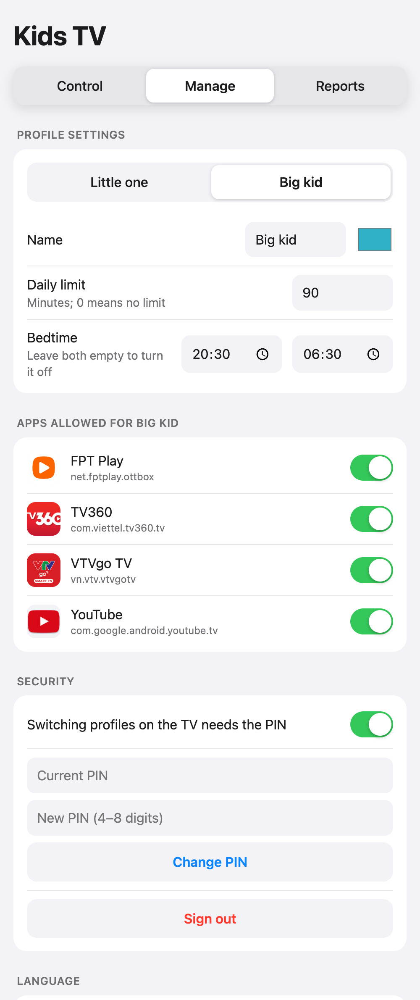
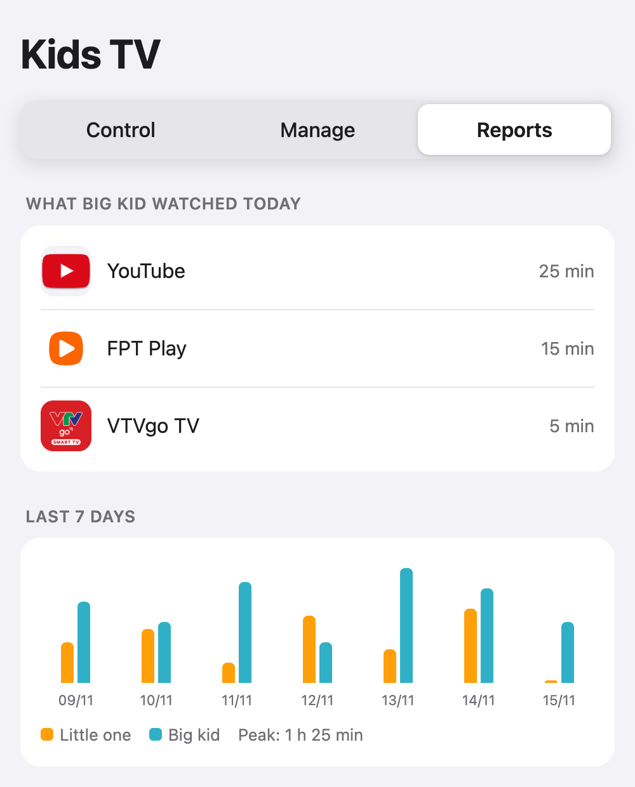

# Kids TV Launcher

[Tiếng Việt](README.md) | **English**

Turn the Android TV box in your children's room into a safe TV: the kids only see the
apps you allow, the TV locks itself when their time is up, and you control everything
from your phone.

No root, no account, no outside service. Everything runs on the box itself and only
inside your home Wi‑Fi network.

## Screenshots

**On the TV** (captured from a real box, shown here in Vietnamese; the TV screens are
also available in English)

| Home screen of a profile | Apps outside the list are locked |
|---|---|
|  |  |

| Bedtime | Entering the parent PIN |
|---|---|
|  |  |

**On the phone** (the admin page rendered with sample data)

| Control | Manage | Reports |
|---|---|---|
|  |  |  |

## What it does

**For the kids**

- A simple home screen with only their apps, no ads and no content suggestions.
- One profile per child, each with its own app list, daily minutes and bedtime.
- When time is up or bedtime arrives, the TV shows a gentle message instead of going
  dark without warning.

**For the parents**

- Every app outside the list, including Settings and the app store, needs the PIN.
- Control from your phone: pause the TV, grant extra time, close the running app, launch
  an app, play a YouTube video, set a sleep timer and wake the TV again.
- See what was watched today and for how long, plus a chart of the last 7 days.
- Vietnamese and English, on both the TV and the phone.

## What you need

- An Android TV box running Android 9 or newer.
- A phone on the same home Wi‑Fi network as the box.
- Someone comfortable with a computer to install the app on the box. This is done once
  and takes about 15 minutes.

## Setup

**1. Have the app installed on the box**

Send the person helping you a link to the
[development guide](DEVELOPMENT.md#first-install-on-a-box). It has every step and the
install file. When they are done, the TV shows the "Create a parent PIN" screen.

**2. Create the PIN**

Use the remote to enter 4 to 8 digits, press OK, then enter them once more. Keep this
code away from the kids.

**3. Open the admin page on your phone**

On the TV, choose "Parents" and enter the PIN: a QR code appears at the top of the
screen. Scan it with your phone camera, then enter the PIN on the phone. On an iPhone,
tap Share → "Add to Home Screen" to get an icon like a regular app.

**4. Set up each child**

Open the **Manage** tab, pick a profile, then set the name, minutes per day and bedtime,
and switch on the apps that child may use. Tap "Save changes".

To change the language, scroll to the bottom of the **Manage** tab and pick "Tiếng Việt"
or "English". The choice applies to the TV screens and the admin page.

### Also recommended

- **Block adult sites** in every app. Ask the person installing the app to turn on the
  family filter while they are at it.
- **Remove browsers, file downloaders and unknown app stores** from the box, because
  they are a way to reach unsuitable content.
- **Use a kids profile inside YouTube** if your child is young. This app controls which
  apps can be opened and for how long; it does not filter what is inside each app.

## Everyday use

### On the TV

- **Switch profile:** choose the round picture at the top right, then pick who is
  watching.
- **Parent mode:** choose "Parents" and enter the PIN. Every app is unlocked for
  15 minutes and the time does not count against the child. Choose "Lock again" when you
  are done.
- **When the TV is locked:** choose "Parent unlock", enter the PIN, then grant 15, 30 or
  60 more minutes.

### On the phone

| Tab | Use it to |
|---|---|
| **Control** | Pause the TV, grant extra time, close or launch an app, play a YouTube link, switch who is watching, set a sleep timer, wake the TV |
| **Manage** | Edit each child's profile, choose allowed apps, change the PIN, change the language |
| **Reports** | See what was watched today and the viewing time over 7 days |

A few tips:

- **Play a YouTube video:** in the YouTube app on your phone, tap Share → Copy link,
  paste it into "Paste a YouTube link" and tap "Play".
- **Sleep timer:** when it runs out, the TV closes the running app and turns the screen
  off. Turn it back on with the remote or the "Wake TV" button on your phone.
- **Lock profile switching:** turn on "Switching profiles on the TV needs the PIN" in
  the Manage tab so a younger child cannot move to an older sibling's profile.

## FAQ

**What if I forget the PIN?**
The app has to be removed and installed again; ask the person who installed it. The PIN
and all profiles are erased and you set everything up from scratch.

**My phone cannot open the admin page.**
Check that the phone is on the home Wi‑Fi, not mobile data. If that is not it, the box's
IP address may have changed; scan the QR code on the TV again. Giving the box a fixed IP
address in your Wi‑Fi router avoids this.

**Can I control it when I am away from home?**
No. The admin page only works while the phone is on the same Wi‑Fi network as the box.

**I tapped "Wake TV" but the TV screen stays dark.**
The button wakes the box. Whether the TV itself turns on depends on its HDMI‑CEC
feature; if it does not, turn the TV on with its own remote.

**Can a child get around it?**
For young children this is a solid barrier. An older, tech-savvy child could still
factory-reset the box with its hardware button, which erases the whole setup.

**Does updating the app lose my data?**
No. A new version keeps the PIN, profiles and viewing time.

**How do I remove the app?**
Ask the person who installed it to follow "Uninstall" in the
[development guide](DEVELOPMENT.md#uninstall). The box returns to Google's original home
screen.

## Safety notes

- The admin page does not encrypt its connection, so use it only on your home network.
  Do not expose port 8765 to the Internet.

## For developers

Building from source, the architecture and the API are covered in
[DEVELOPMENT.md](DEVELOPMENT.md).
